# From ATE to CATE: Benchmarking Causal Forests, Meta-Learners, and DR/R-Learning on 14 Million Randomized Ad Exposures

*A methods-comparison study on Criteo's uplift-modeling benchmark, framed around
the decision a growth or underwriting team actually faces: **who should we
target, and does the estimator we pick change the answer?***

---

## 1. Why this dataset, and why this question

Criteo's Uplift Modeling dataset is one of the few large-scale public datasets
built from a **genuine randomized experiment**: 13,979,592 users, a random 15%
held out from advertising, binary `visit` and `conversion` outcomes, and 12
anonymized dense features per user. Because assignment is truly randomized,
there is no confounding to argue about — which is exactly what makes it a clean
proving ground for causal ML. We can spend all of our attention on *method*
rather than *identification*.

The average treatment effect (ATE) is not the interesting object here. Averaged
over everyone, the ad "works" — that is nearly tautological and commercially
useless, because you rarely want to (or can afford to) treat everyone. The
decision-relevant object is the **conditional average treatment effect (CATE)**:
the incremental effect *for a given user*. Three nested questions follow.

1. **Targeting.** Can we find a sub-population whose incremental effect is large
   enough to justify cost, and how small can the targeted set be while keeping
   most of the aggregate lift? (The Qini / uplift-curve question.)
2. **Estimator choice.** How much do CATE estimates *disagree* across methods —
   S-, T-, X-learner, DR-learner, R-learner, and a causal forest — on identical
   data?
3. **Robustness.** Since treatment is randomized, we can run a **placebo test**:
   shuffle the treatment label and confirm each estimator correctly reports *no*
   heterogeneity.

## 2. Setup

**Treatment.** We use the randomized `treatment` flag (intent-to-treat). We
deliberately do **not** condition on `exposure` (whether the user was actually
shown an ad): exposure is realized *after* randomization and is not itself
randomized, so conditioning on it would smuggle confounding back in through the
back door.

**Outcome.** `visit` (base rate ≈ 4.7%) is the primary outcome — it has enough
events to estimate heterogeneity stably. `conversion` (≈ 0.29%) is a rare-event
stress test.

**Propensity.** By construction P(treatment = 1) ≈ 0.85 for *everyone*. The
propensity models we fit recover a near-constant 0.85, so the orthogonalization
inside the DR/DML estimators is well-behaved — a luxury real observational data
never affords.

**Shared base learners.** Every estimator is built on the *same*
HistGradientBoosting base models. This is a deliberate control: any divergence
in the CATE estimates is attributable to the estimator's **meta-structure**, not
to one method secretly getting a stronger base learner.

**Compute.** We develop on a stratified 500k subsample (rates preserved to four
decimals), then re-run at scale on a 4M-row training / 1M-row evaluation draw
from the full 14M. As §7 shows, that scale-up does more than confirm numbers —
it changes the ranking, which turns out to be the most useful result in the piece.

## 3. The six estimators in one paragraph each

- **S-learner** — one model on `[X, T]`; reads CATE off the T-coefficient
  surface. Simple, but tends to *regularize the treatment signal toward zero*
  when the effect is small relative to outcome variation.
- **T-learner** — separate models for treated and control; CATE is their
  difference. Flexible, but the two models' independent errors add up and can
  manufacture spurious heterogeneity.
- **X-learner** — imputes individual effects then blends them with the
  propensity; designed for **imbalanced** treatment arms — which is exactly our
  85/15 split.
- **DR-learner** — a doubly-robust pseudo-outcome regressed on features;
  consistent if *either* the outcome or the propensity model is right.
- **R-learner** — Robinson-style residual-on-residual (non-parametric DML);
  orthogonalizes out the nuisance functions before estimating the effect.
- **Causal Forest (GRF)** — a forest whose splits target treatment-effect
  heterogeneity directly, with honest estimation and (near-)valid confidence
  intervals.

## 4. Targeting: the Qini curve

<!-- FIG:qini -->
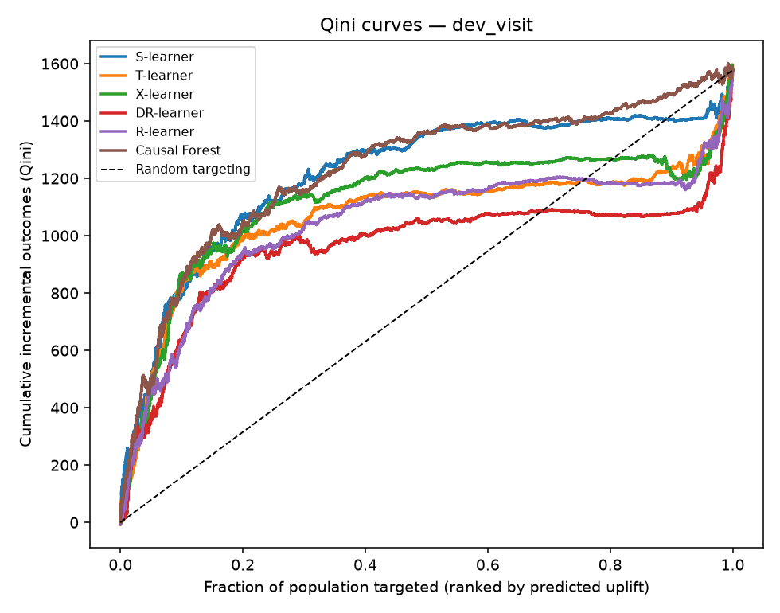

**How to read it.** The x-axis is the fraction of users targeted, ranked by each
estimator's predicted uplift; the y-axis is cumulative incremental visits. The
dashed line is random targeting. The higher and more bowed-out a curve, the more
lift you capture by treating fewer people.

**The numbers (500k development sample, `visit` outcome).** The held-out ATE is
**+1.24 percentage points** — treated users visit at ≈4.85% vs ≈3.82% for
control. But the targeting payoff is where it gets interesting. Using the best
ranker (the causal forest), the top-ranked users are wildly more responsive than
average:

| Targeted share (top-k by predicted uplift) | Share of positive incremental visits captured |
|:--|:--|
| top 10% | **64%** |
| top 20% | 74% |
| top 30% | 77% |
| top 50% | 87% |

Half the population is essentially dead weight: **treating the top 30% recovers
~77% of the achievable lift.** For a campaign with per-impression cost, that is
the difference between a profitable and an unprofitable program — and it is
invisible if you only look at the ATE.

The **Qini coefficient** (area between a curve and the random line, normalised)
summarises each ranker in one number:

| Estimator | Qini coefficient | Mean CATE | CATE std | Fit time (s) |
|:--|--:|--:|--:|--:|
| **Causal Forest** | **0.561** | 0.0061 | 0.017 | 61.9 |
| S-learner | 0.539 | 0.0059 | 0.022 | 5.5 |
| X-learner | 0.417 | 0.0065 | 0.037 | 6.5 |
| T-learner | 0.351 | 0.0066 | 0.042 | 2.3 |
| R-learner | 0.315 | 0.0068 | 0.047 | 10.4 |
| DR-learner | 0.215 | 0.0066 | 0.061 | 11.3 |

Two things jump out. First, **the ranking spans a 2.6× spread in Qini** (0.22 to
0.56) — estimator choice is not a rounding error, it materially changes how good
your targeting is. Second, and counter-intuitively, **the two best rankers are
the two with the *smallest* CATE spread.** The causal forest and S-learner are
the most regularized; the DR- and R-learners produce the widest, most confident
individual effects and rank the *worst*. Hold that thought — the placebo test in
§6 explains exactly why.

> **A note on levels vs. ranking.** The mean CATE (~0.006) sits *below* the
> diff-in-means ATE (~0.010–0.012). This is not a bug: with only 15% of users in
> the control arm, the regularized control regressor pulls its predictions toward
> the pooled ≈4.7% visit rate, over-stating the counterfactual and shrinking
> every meta-learner's estimated effect. It is the textbook motivation for the
> **X-learner**, which was designed for exactly this imbalanced-arm setting. For
> *targeting* it barely matters — the Qini curve depends only on the *ranking* of
> users, not the absolute level — but it is a caution against reading a
> meta-learner's CATE as a calibrated individual effect.

## 5. Do the estimators agree?

If every method told the same story, "estimator choice" would be a non-issue.
They don't.

<!-- FIG:agreement -->
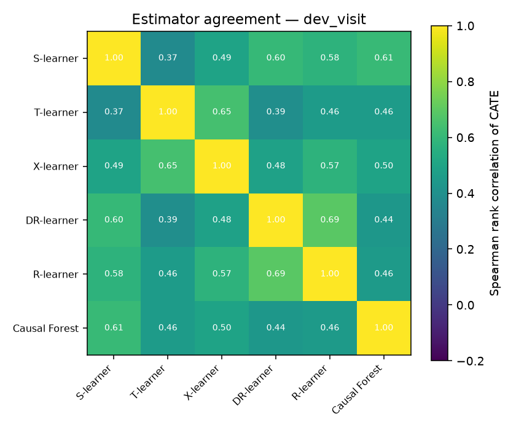

<!-- FIG:cate_dist -->
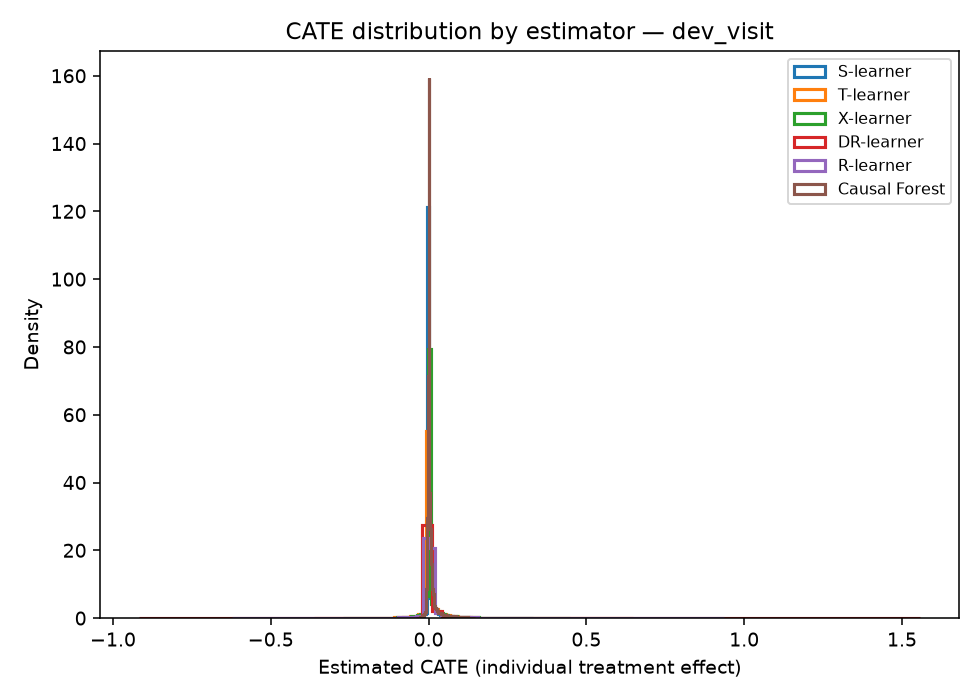

**Pairwise Spearman rank correlation of the six CATE vectors ranges from just
0.38 to 0.69.** Even the *most* similar pair of methods agrees on the user
ranking only ~70% as measured by rank correlation; the least similar pair
(S-learner vs T-learner, 0.38) barely agree at all. If you handed six analysts
one of these estimators each and asked "who should we target," they would hand
back materially different lists.

The disagreement is starkest on a question a risk team would care about: **how
many users does the model think are actively *harmed* by treatment** (negative
CATE)? The answer ranges from **4% (S-learner) to 44% (R-learner)** on the exact
same data. The regularized methods say almost everyone benefits a little; the
flexible methods carve the population into large "helped" and "hurt" camps. Both
cannot be right, and under a randomized design with a clean ATE we have the
tools to say which is closer to the truth.

The **uplift-by-decile** plot is the honest test of a ranker: bin users by
*predicted* uplift, then read off the *observed* treated-minus-control rate in
each bin on held-out data. A good ranker declines monotonically.

<!-- FIG:deciles -->
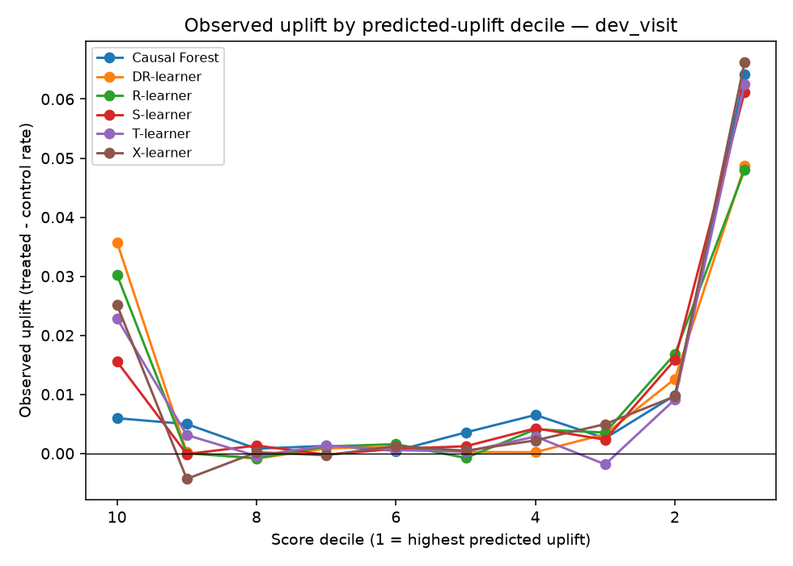

## 6. The negative control (placebo test)

This is the section most Kaggle-style writeups skip. Randomization gives us a
free, unambiguous null: **permute the treatment label** and any real effect is
destroyed by construction, while marginal rates are preserved. A trustworthy
estimator should then find *nothing* — its Qini should collapse toward zero.

<!-- FIG:placebo -->
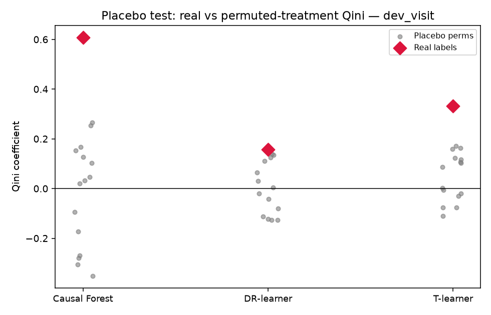

We permute the treatment label on the training set (15 times), refit, and score
each placebo model's Qini against the *real* held-out labels. The red diamonds
are the real-label Qini; the grey clouds are each estimator's own null. (The
placebo pass uses a lighter 100-tree causal forest for speed, so its real-label
Qini values differ slightly from §4's 400-tree table — the comparison that
matters is each estimator's real value against *its own* null, not across
tables.)

| Estimator | Real Qini | Placebo mean | Placebo p95 | z vs. null |
|:--|--:|--:|--:|--:|
| Causal Forest | 0.608 | −0.020 | 0.256 | **3.10** |
| T-learner | 0.332 | 0.048 | 0.166 | **3.05** |
| DR-learner | 0.158 | 0.010 | 0.148 | **1.40** |

Two lessons, and they are the payoff of the whole piece.

**First, the null is not zero — it is wide.** A flexible estimator handed pure
noise can still manufacture a Qini coefficient as high as **+0.26** (causal
forest) purely by overfitting the evaluation sample. If you had reported a single
Qini of, say, 0.2 with no benchmark, you would have had no idea whether it was
signal or an artifact. **The placebo band is the yardstick that tells you which.**

**Second, it vindicates the §4 ranking for the right reason.** The causal forest
and T-learner clear their own null by ~3 standard deviations — their
heterogeneity is real. The **DR-learner does not**: its real-label Qini (0.158)
sits *below its own placebo 95th percentile* (0.148), a z of just 1.4. The method
that produced the most confident-looking individual effects — and split 43% of
users into a "harmed" bucket — is the one whose apparent signal is
**statistically indistinguishable from permuted-label noise.** Its wide CATE
distribution was flexibility, not effect.

This is the section a hiring manager from a causal-inference or econometrics
background will read twice. It is the same instinct as a placebo regression or a
VAR robustness check: *before you believe a positive result, show that your
method correctly returns nothing when nothing is there.* (One caveat, resolved in
§7: this placebo verdict is a statement about the **500k** sample. The
DR-learner's failure here is a small-sample-variance story, not a fundamental
one — at 4M rows it recovers cleanly.)

## 7. What 14 million rows change — disagreement is a finite-sample story

If the piece stopped at §6 it would tell a tidy but *misleading* story: "flexible
DML methods overfit, use a causal forest." Re-running everything on a 4M-row
training / 1M-row evaluation draw dissolves most of that.

<!-- FIG:qini_full -->
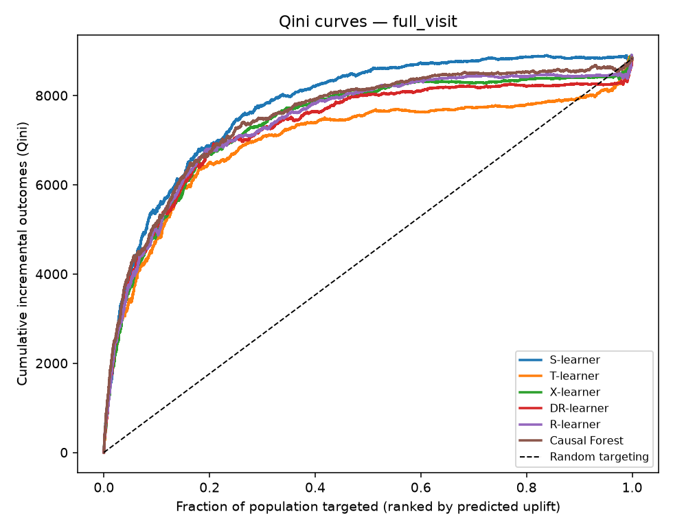

The curves that fanned out at 500k now bunch together. Concretely, the Qini
coefficients move like this:

| Estimator | Qini @ 500k | Qini @ 4M | % judged "harmed" @ 500k → @ 4M |
|:--|--:|--:|:--:|
| S-learner | 0.539 | **0.758** | 4% → 1% |
| Causal Forest | 0.561 | 0.701 | 28% → 23% |
| R-learner | 0.315 | 0.675 | 44% → **3%** |
| X-learner | 0.417 | 0.668 | 15% → 3% |
| DR-learner | 0.215 | 0.646 | 44% → **2%** |
| T-learner | 0.351 | 0.578 | 35% → 15% |

Three things happen at once:

1. **The spread collapses.** The Qini range narrows from 2.6× (0.22–0.56) to
   1.3× (0.58–0.76). With enough data the estimators largely agree on *who* to
   target — pairwise rank correlation rises from 0.38–0.69 to **0.47–0.89**, and
   the four cross-fitting methods (S-, X-, DR-, R-learner) now agree at 0.78–0.89.

2. **The data-hungry methods recover.** The DR- and R-learners — dead last at
   500k, and the ones the placebo test flagged — climb to the middle of the pack.
   Their "44% of users are harmed" claim, which looked alarming in §5, was almost
   entirely finite-sample noise: at 4M it falls to 2–3%. Doubly-robust and DML
   estimators have more nuisance functions to learn, so they *need* volume; give
   it to them and they behave.

3. **The ranking reshuffles, but the robust methods stay robust.** The
   **S-learner** — cheapest to fit — is now the single best ranker (Qini 0.76),
   with the causal forest a close second. These two were the top pair at 500k too.
   The lesson is not "S-learner wins"; it is that the *regularized* estimators
   were trustworthy at both scales, while the flexible ones were only trustworthy
   at scale.

We can watch all of this happen by sweeping the training size from 50k to 4M and
scoring every estimator on one fixed 1M-row evaluation set:

<!-- FIG:scaling -->
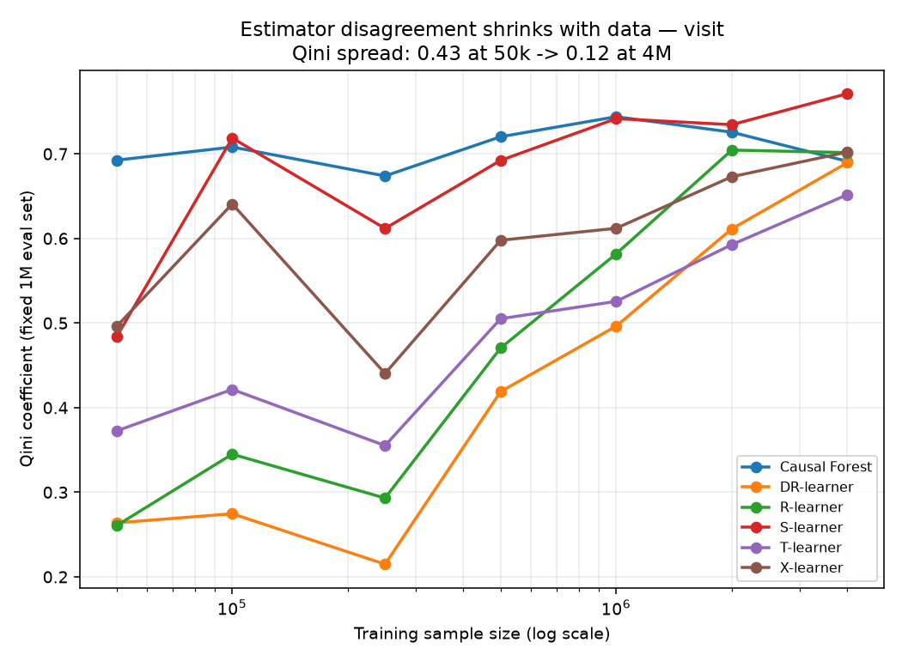

The picture is unambiguous. **The causal forest and S-learner are essentially
flat and high from 50k onward** — they are the sample-efficient methods, extract
most of the ranking signal from a small sample, and barely improve with more.
The **DR-, R-, X-, and T-learners start far below (Qini ≈ 0.26–0.37 at 50k) and
climb steeply**, only catching up around 2–4M rows. The vertical gap between the
best and worst estimator — the cost of picking wrong — shrinks from **0.43 at
50k to 0.12 at 4M.** Estimator choice is a small-sample problem.

**Re-running the placebo test at scale closes the loop.** In §6 the DR-learner
failed its negative control on 500k rows — its real Qini (0.158) sat *below* its
own placebo 95th percentile, a z of just 1.4. Repeating that test on the 4M-row
training set flips the verdict cleanly:

<!-- FIG:placebo_full -->
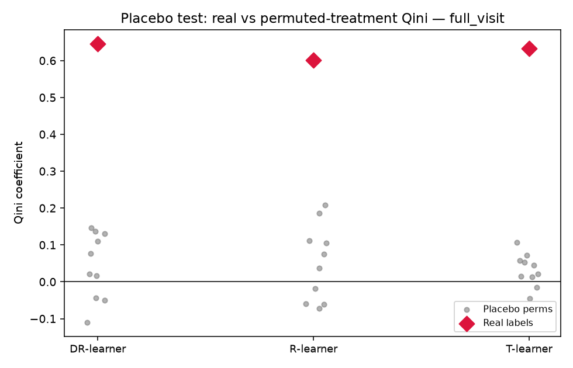

| Estimator | z vs. null @ 500k | z vs. null @ 4M |
|:--|--:|--:|
| DR-learner | 1.4 (fails) | **7.0** |
| R-learner | — | 5.6 |
| T-learner | 3.1 | 14.4 |

At 4M the DR-learner clears its permuted-label null by **seven standard
deviations** (real Qini 0.646 vs. a null centred at 0.044). Its heterogeneity was
real all along — it just needed the data to resolve it above the noise floor. The
null tightens with scale too (its spread shrinks as *n* grows), so more data both
strengthens the real signal and sharpens the yardstick you measure it against.
This is the cleanest possible confirmation of the section's thesis: the estimator
that looked like it was overfitting at 500k was, in fact, *under-powered* — and
the placebo test, run at your actual data budget, is what tells the two apart.

And the targeting story gets sharper, not weaker: at 4M the best ranker puts
**82% of the incremental visits in the top 10%** of users (95% in the top 30%).

**The decision-relevant takeaway:** estimator choice matters *most exactly when
you have least data* — which is precisely when a team can least afford to guess.
With 500k rows the choice swung Qini 2.6×; with 4M it barely mattered. So the
practical rule is: at small scale, prefer regularized estimators (S-learner,
causal forest) **and run the placebo check**; as data grows, the DML family
becomes safe and the choice matters less.

## 8. What a decision-maker should take away

Three things, in the order a decision-maker should care about them.

1. **Targeting is where the money is.** The ATE says "ads work." The Qini curve
   says *you do not need to treat everyone*: at scale the top 10% of users by
   predicted uplift carry ~82% of the incremental visits (top 30% → 95%). For any
   campaign with non-trivial cost-per-contact — a re-engagement push, a
   credit-line offer — that is the entire business case, and it is invisible in
   the ATE.

2. **Estimator choice matters most when data is scarce.** At 500k rows the six
   methods spanned a 2.6× Qini range and disagreed on which users were even
   *helped* vs *harmed* (4%–44%); at 4M that spread collapsed to 1.3× and the
   disagreement to 1–3%. Much of the "which estimator?" anxiety is a finite-sample
   phenomenon. The regularized estimators (S-learner, causal forest) were
   trustworthy at *both* scales; the doubly-robust / DML methods needed volume.
   So: small data → prefer regularized methods and verify; large data → the choice
   is second-order.

3. **The placebo test is the discipline that tells you which regime you're in.**
   It is cheap (you already have the estimator code), only *available* because the
   data is randomized, and it is exactly what flagged the DR-learner's 500k
   heterogeneity as noise — a diagnosis §7 then confirmed by scaling up. Most
   write-ups of this dataset stop at a single Qini number; benchmarking every
   estimator against its own permuted-label null, at your actual data budget, is
   the step that turns "look at my forest" into a defensible recommendation.

## 9. Appendix — the rare-event stress test: `conversion`

Everything above used `visit` (base rate ≈ 4.7%). The commercially decisive
outcome is `conversion`, but it fires for only **0.29%** of users — roughly 16×
rarer. Does the story survive when positive events are scarce? We repeat the full
4M-row run on `conversion`.

<!-- FIG:qini_conv -->
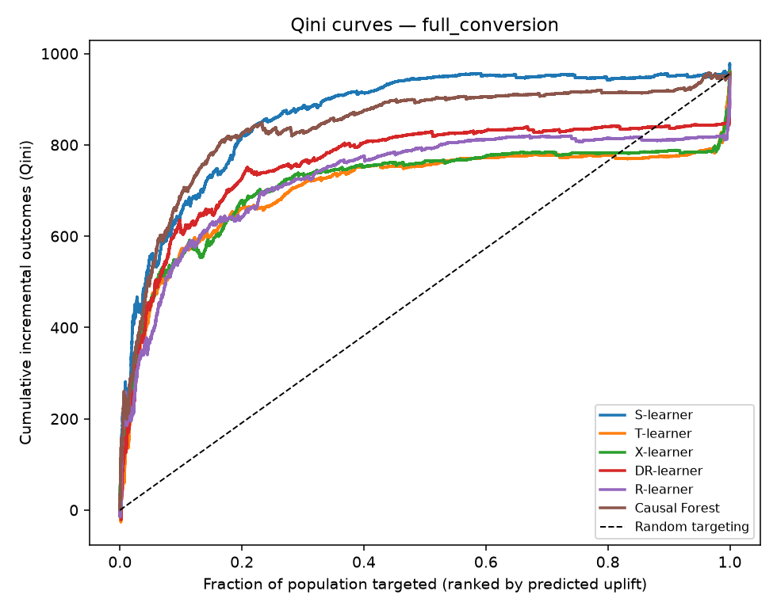

| Estimator | Qini (conversion) | Qini (visit) |
|:--|--:|--:|
| S-learner | **0.810** | 0.758 |
| Causal Forest | 0.757 | 0.701 |
| DR-learner | 0.589 | 0.646 |
| R-learner | 0.523 | 0.675 |
| X-learner | 0.491 | 0.668 |
| T-learner | 0.474 | 0.578 |

Two things carry over and one sharpens the §7 thesis.

- **The same two estimators lead.** S-learner and the causal forest are again the
  top pair, by a clear margin — more evidence that the regularized methods are the
  safe default.
- **Targeting is, if anything, more valuable here.** The ATE on conversion is a
  tiny +0.11pp, yet the best ranker still concentrates **82% of the incremental
  conversions in the top 10%** of users. For the outcome you actually monetise,
  the ability to target is the whole game.
- **Disagreement widens again — exactly as the sample-size story predicts.** The
  Qini spread on conversion is **1.7×** (0.47–0.81) versus 1.3× on visit at the
  same 4M rows. A 0.29% outcome gives you only ~1/16th the *effective* sample of a
  4.7% outcome, so 4M conversion rows behave like a much smaller visit dataset —
  and the estimators fan back out, just as §7 would predict. Rare-event uplift is
  a small-sample regime in disguise, which is exactly when estimator choice, and
  the placebo check, matter most.

The three diagnostic views from §4–§5, repeated for `conversion`, make the
pattern concrete.

<!-- FIG:deciles_conv -->
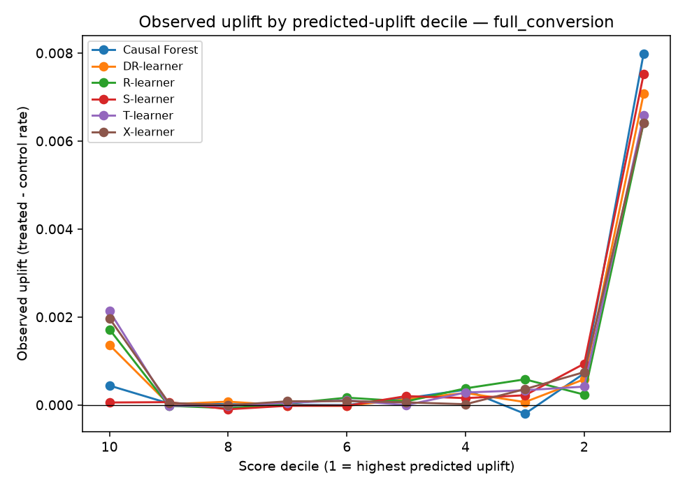

The ranking is genuine but *brutally* concentrated: essentially all of the
incremental conversions sit in the single top decile (~0.008 observed uplift),
with every other decile flat at zero. That is the decile-level face of the "82%
in the top 10%" number — and a reminder that for a 0.29% outcome there is almost
no signal to spread across the rest of the population.

<!-- FIG:agreement_conv -->
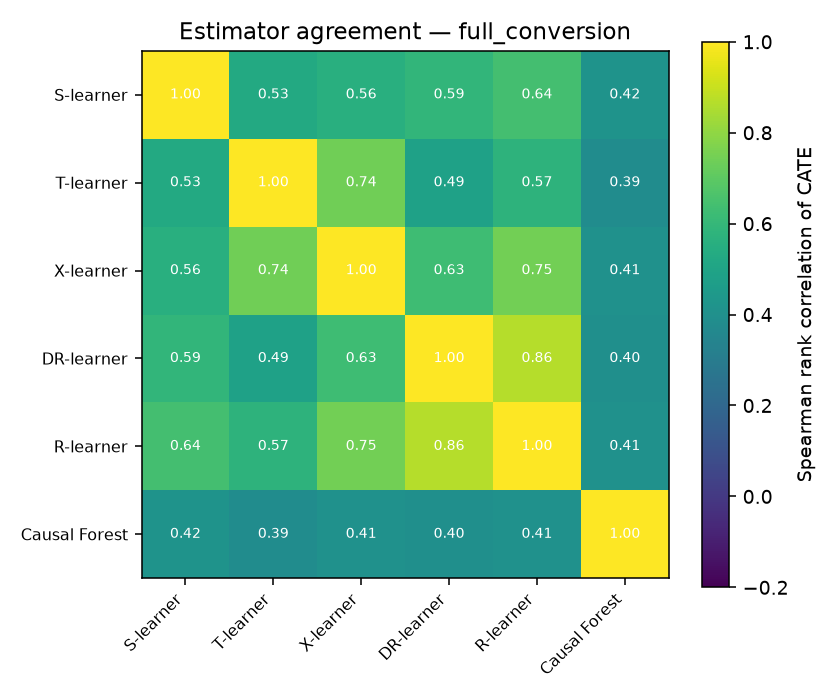

Rank agreement is looser than on `visit` (Spearman 0.39–0.86), and the causal
forest is the visible outlier — it correlates only ~0.40 with every other method,
because on this rare outcome its honest, deeply-split trees carve out a different
(and more negative-tailed) heterogeneity structure than the smoother meta-learners.
It still ranks second, so "different" is not "wrong" — but it is a concrete case
of two defensible methods disagreeing on *who* to target.

<!-- FIG:cate_dist_conv -->
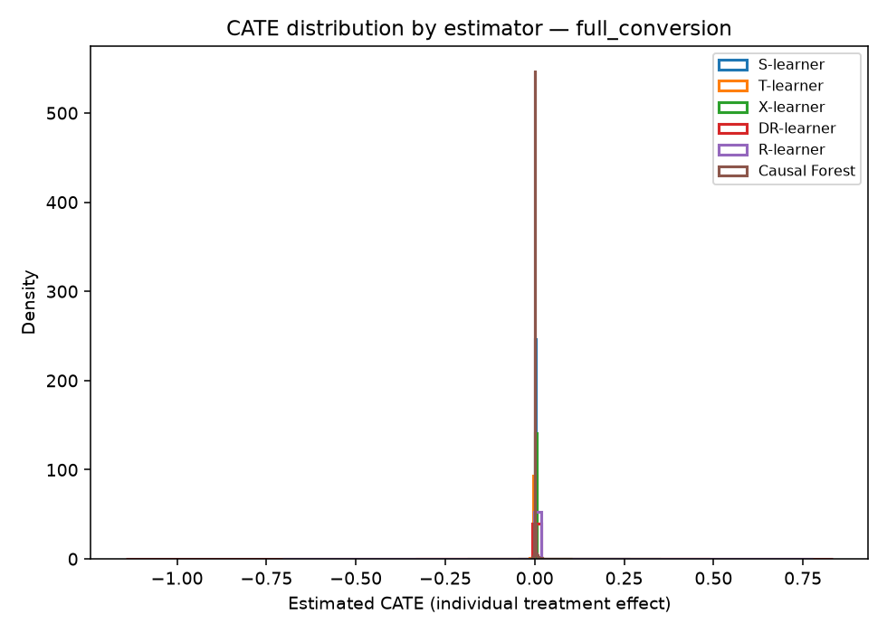

The CATE distributions show why the Qini spread widens: the doubly-robust and DML
learners (DR, R) carry the heaviest tails at this sample size, while the S-learner
and causal forest stay tight around a small positive effect — the same
regularized-vs-flexible split seen on `visit`, amplified by the scarcity of
conversion events.

## 10. Reproducibility

All code, the exact environment, and the commands that produced every figure and
table are in the [repository README](../README.md). Nothing here depends on a
private dataset or a manual step.

---

*Dataset: Diemert, Betlei, Renaudin & Amini, "A Large Scale Benchmark for Uplift
Modeling," AdKDD 2018.*
